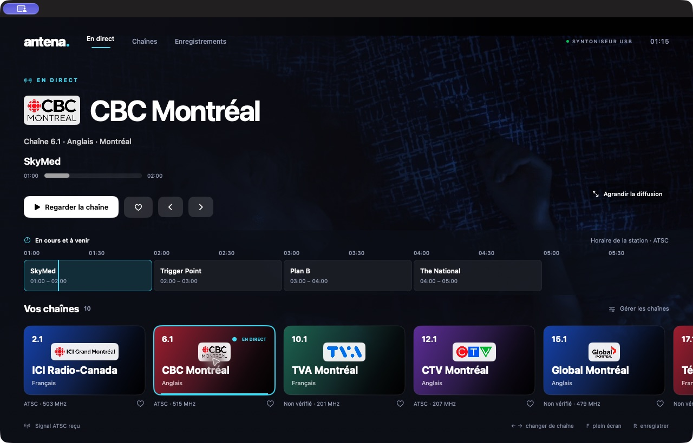
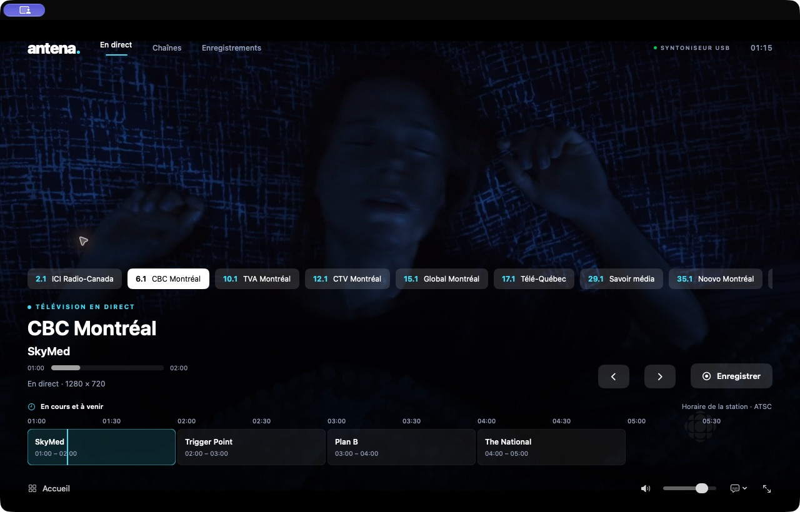

# Antena — Télévision ATSC en direct pour macOS

[English](README.md) · [Español](README.es.md) · [Français](README.fr.md)

Antena est une application native SwiftUI/AppKit pour regarder la télévision hertzienne avec un syntoniseur USB **KWorld VS-ATSC 330U**. Elle comprend un pilote C en espace utilisateur, la lecture avec libVLC, l’enregistrement MPEG-TS facultatif, la gestion des chaînes et les logos des stations.

Le projet cible **macOS 27 ou ultérieur sur Apple Silicon** et s’ouvre directement dans **Xcode 27**. C’est un projet expérimental pour ce matériel, et non un pilote officiel de KWorld. La documentation principale et les identifiants du code sont en anglais.

## Captures d’écran

Captures réelles d’Antena recevant CBC Montréal avec le syntoniseur USB. L’interface et les commandes sont présentées en français.

### Accueil

Logos des chaînes, émission en cours et guide horizontal des émissions à suivre, avec la vidéo en direct.



### Lecteur en direct

Changement rapide de chaîne et commandes d’enregistrement, de volume, de sous-titres et de plein écran. Les commandes se masquent automatiquement pendant la lecture.



Les images des émissions et les logos appartiennent à leurs détenteurs respectifs.

## Sommaire

1. [Fonctions et état](#fonctions-et-état)
2. [Configuration requise](#configuration-requise)
3. [Compiler et exécuter](#compiler-et-exécuter)
4. [Regarder et enregistrer](#regarder-et-enregistrer)
5. [Chaînes et catalogues par ville](#chaînes-et-catalogues-par-ville)
6. [Langues](#langues)
7. [Aperçus Xcode](#aperçus-xcode)
8. [Pilote en ligne de commande](#pilote-en-ligne-de-commande)
9. [Architecture et fichiers](#architecture-et-fichiers)
10. [Tests et diagnostic](#tests-et-diagnostic)
11. [Dépannage](#dépannage)
12. [Préparer un dépôt public](#préparer-un-dépôt-public)
13. [Limites et licences](#limites-et-licences)

## Fonctions et état

- Vidéo et audio en direct sans créer de fichier vidéo; le décodeur utilise un tampon mémoire de taille limitée.
- Accueil avec logos, favoris, changement rapide de chaîne et saisie numérique.
- Commandes masquées après 3,5 secondes d’inactivité, plein écran, volume et sourdine.
- Sélection des sous-titres lorsque la diffusion fournit des pistes compatibles.
- Titre du programme diffusé, horaires, progression et ligne du temps horizontale commençant par le programme actuel.
- Enregistrement explicite en `.ts`, lecture depuis l’icône vidéo ou le bouton Lire, affichage dans le Finder et retrait automatique des entrées sans fichier.
- Recherche de villes du monde entier, indication de fréquence et de compatibilité de la norme, modification manuelle et recherche hertzienne RF 2–36.
- Interface en anglais, espagnol et français, sélectionnée automatiquement selon macOS.
- Aperçus SwiftUI isolés pour concevoir les écrans sans activer le syntoniseur.

La réception a été vérifiée avec le matériel réel sur Apple Silicon/macOS 27.0.1, notamment ICI Radio-Canada à **503 MHz** et CBC Montréal à **515 MHz**, avec lecture vidéo et audio. Ces observations ne garantissent pas la réception ailleurs. Les premières mesures du transport sont conservées dans [reception-test.txt](docs/reception-test.txt); elles décrivent ce test précis et non tous les tests ultérieurs de l’application.

## Configuration requise

| Élément | Condition |
| --- | --- |
| Mac | Apple Silicon; la cible de l’application et le moteur fourni sont arm64 |
| Système | macOS 27 ou ultérieur |
| Développement | Xcode 27, outils de ligne de commande actifs, `make`, Swift |
| Syntoniseur | KWorld VS-ATSC 330U, VID/PID USB `eb1a:a316` |
| Composants | EM2883 (`0x24`), démodulateur S5H1409 et syntoniseur XC3028 |
| Signal | ATSC 1.0 terrestre 8VSB, 6 MHz; antenne branchée |
| Moteur multimédia | libVLC 3.0.24 arm64 dans `Vendor/VLC/` |
| Micrologiciel | `firmware/xc3028-v27.fw` vérifié |
| Stockage | Espace pour les caches de compilation et l’application temporaire, ainsi que les enregistrements choisis |

Internet est nécessaire pour préparer VideoLAN, importer des catalogues en ligne ou télécharger des logos distants. Une application déjà préparée peut syntoniser une fréquence enregistrée sans Internet. Le catalogue et les dix logos de Montréal sont inclus.

## Compiler et exécuter

### Compiler depuis la racine du projet

```sh
./script/build_and_run.sh --verify
```

Le script compile et ouvre Antena. `--verify` vérifie aussi le démarrage du processus, pas la réception. Pour choisir un dossier reproductible de produits de compilation :

```sh
ANTENA_DERIVED_DATA="$PWD/build/Xcode" ./script/build_and_run.sh --verify
```

Les produits sont placés dans le dossier DerivedData sélectionné. Lorsque la signature nécessite une copie sur APFS, le script prépare `/private/tmp/Antena-Local/Antena.app` et ouvre cette copie. L’application temporaire peut être recréée avec le script. Consultez [les détails de compilation](docs/BUILD.md).

### Une nouvelle copie des sources

Exécutez les commandes depuis la racine. Préparez VideoLAN avec le script et fournissez le micrologiciel exact décrit dans [sa provenance](firmware/PROVENANCE.md) avant de le vérifier :

```sh
./script/bootstrap_vlc.sh
./script/antena_tools.sh verify-firmware
./script/build_and_run.sh
```

Le script télécharge la distribution arm64 officielle de VideoLAN et vérifie son SHA-256 fixé. Les binaires VideoLAN et le micrologiciel ne sont pas suivis dans Git. La compilation normale ne télécharge pas automatiquement les dépendances absentes. La provenance et l’extraction du micrologiciel sont documentées; aucune commande d’acquisition automatique n’est fournie.

Le micrologiciel attendu fait **66 220 octets**, version **2.7**, avec **80 images**, SHA-256 :

```text
0d4cfd7974a19a94f4d42eb2d160d5a3e71cca1cfa61bd2cc063cf3f36ffd32e
```

Le pilote le vérifie avant la syntonisation et le charge dans la RAM du syntoniseur, sans écrire son EEPROM.

### Xcode

Ouvrez `Antena.xcodeproj`, sélectionnez le schéma **Antena** et la destination **My Mac**. Sur APFS, compilez et exécutez avec `⌘B` et `⌘R`. Le flux local de signature ad hoc ne nécessite pas de compte développeur payant. Pour compiler directement dans Xcode, placez DerivedData sur APFS avec suffisamment d’espace. Le script gère également les compilations nécessitant une copie sur APFS.

`script/Tools/ProjectGenerator.swift` régénère le projet de façon déterministe. Lors d’une modification de sa structure ou des réglages générés, mettez également le générateur à jour. Il exclut les métadonnées `._*` et affiche le programme USB et les tests sans les ajouter à la cible de l’application.

## Regarder et enregistrer

Le programme actuel et une ligne du temps horizontale de six heures apparaissent lorsque la station fournit des données ATSC PSIP utilisables. Titres, horaires et progression proviennent du signal, sans enregistrer la vidéo. Consultez [les détails du guide et les limites de codage](docs/PROGRAM_GUIDE.md).

Au démarrage, Antena syntonise la première chaîne de la bibliothèque sauvegardée et affiche l’accueil. Cliquez sur une carte pour changer de chaîne ou sur **Regarder la chaîne** pour privilégier la vidéo. Déplacez le pointeur ou appuyez sur une touche pour réafficher les commandes.

L’enregistrement commence seulement après **Enregistrer** et la confirmation du fichier de destination. Il sauvegarde le transport MPEG reçu sans réencodage, à partir du point actuel du direct. Les fichiers existants ne sont pas écrasés. Arrêter l’enregistrement laisse le direct actif; changer de chaîne ou fermer l’application termine l’enregistrement en cours. Le fichier contient le transport reçu, éventuellement plusieurs programmes et des données, et non un MP4 exporté d’un seul programme.

L’icône vidéo et le bouton **Lire** démarrent la lecture. Les entrées sans fichier sont retirées à l’ouverture de cette vue, au retour dans Antena et lors de vérifications périodiques pendant son affichage. Les fichiers existants ne sont pas supprimés.

Dans **Enregistrements**, vous pouvez lire les éléments de la bibliothèque ou afficher leurs fichiers dans le Finder. **Fichier → Ouvrir un enregistrement…** ouvre un fichier externe. Les sous-titres dépendent de la diffusion et du décodeur; Antena ne les génère pas. Changer la langue de l’interface ne traduit ni l’audio ni les sous-titres diffusés.

| Raccourci | Action |
| --- | --- |
| `←` / `→`, Page précédente / Page suivante | Chaîne précédente / suivante |
| Chiffres et `.` | Saisir une chaîne virtuelle, par exemple `6.1` |
| `L` | Dernière chaîne |
| `F` | Plein écran |
| `R` | Démarrer / arrêter l’enregistrement |
| `M` | Activer / désactiver la sourdine |
| `C` | Activer / désactiver la première piste de sous-titres disponible |
| `Esc` | Quitter le plein écran ou revenir à l’accueil |
| `⌘O` | Ouvrir un enregistrement |
| `⌘,` | Réglages |

Le menu Télévision propose également les commandes de chaînes et d’enregistrement avec leurs raccourcis affichés.

## Chaînes et catalogues par ville

Dans **Chaînes**, indiquez une ville de tout pays, éventuellement avec son pays ou sa région, puis cliquez sur **Rechercher et importer**. Wikipédia et Wikidata identifient le lieu et les fiches terrestres disponibles. Seules les fréquences RF ou MHz publiées sont utilisées; un numéro virtuel ne devient jamais une fréquence RF. Les chaînes et favoris existants sont conservés.

L’importation d’un catalogue ne teste pas le signal. **Rechercher des chaînes** utilise le syntoniseur physique sur RF 2–36 et interrompt le direct. Les nouvelles fréquences peuvent porter une étiquette RF jusqu’à leur renommage. La saisie manuelle utilise les MHz; les commandes du pilote utilisent les Hz.

Le catalogue de Montréal inclus a été documenté le 22 octobre 2026. C’est un point de départ, pas une garantie de réception de toutes les stations :

| Virtual | Station | RF | MHz |
| --- | --- | --- | --- |
| 2.1 | ICI Radio-Canada · CBFT-DT | 19 | 503 |
| 6.1 | CBC Montréal · CBMT-DT | 21 | 515 |
| 10.1 | TVA Montréal · CFTM-DT | 11 | 201 |
| 12.1 | CTV Montréal · CFCF-DT | 12 | 207 |
| 15.1 | Global Montréal · CKMI-DT-1 | 15 | 479 |
| 17.1 | Télé-Québec · CIVM-DT | 26 | 545 |
| 29.1 | Savoir média · CFTU-DT | 29 | 563 |
| 35.1 | Noovo Montréal · CFJP-DT | 35 | 599 |
| 47.1 | ICI Télé · CFHD-DT | 31 | 575 |
| 62.1 | Citytv Montréal · CJNT-DT | 17 | 491 |

La recherche mondiale dépend de la couverture et du format des sources publiques; des listes complètes ne sont pas garanties pour chaque ville. Les fiches sans fréquence ou avec une norme incompatible restent au catalogue et ne sont pas syntonisables avec ce récepteur ATSC 1.0. Montréal utilise son catalogue inclus si la consultation est indisponible. Consultez [les détails du catalogue](docs/CHANNELS.md) et [l’attribution des logos](docs/channel-logo-sources.json).

## Langues

L’anglais est la langue de développement et de repli. Par défaut, Antena suit la liste des langues préférées de macOS et sélectionne l’anglais, l’espagnol ou le français, y compris les variantes régionales comme `es-CA` et `fr-CA`. Si aucune préférence prise en charge ne correspond, l’anglais est utilisé.

**Antena → Réglages → Langue de l’interface** permet de choisir **Suivre macOS**, **English**, **Español** ou **Français**. Les changements manuels s’appliquent à la prochaine ouverture. Les identifiants, noms des aperçus et clés de localisation restent en anglais. Les traductions se trouvent dans `Antena/Resources/en.lproj`, `es.lproj` et `fr.lproj`, affichées comme `Localizable.strings` dans Xcode. Les noms des stations conservent leur orthographe officielle.

## Aperçus Xcode

Sélectionnez un fichier dans `Antena/Views`, puis activez **Editor → Canvas** (`⌥⌘↩`). Cliquez sur **Resume** si Xcode suspend les aperçus. Les aperçus couvrent l’accueil, le lecteur, les chaînes, les enregistrements, les logos et les cartes; les réglages de langue sont désactivés dans leur aperçu.

Les aperçus utilisent des données d’exemple en mémoire et une illustration comme fond vidéo. Ils n’ouvrent pas le syntoniseur USB, n’enregistrent pas de vidéo, ne consultent pas le catalogue et ne modifient pas les préférences de chaînes sauvegardées. Exécutez l’application pour recevoir la télévision réelle.

## Pilote en ligne de commande

Le programme natif utilise IOKit/IOUSBLib en espace utilisateur; il n’installe pas d’extension du noyau et n’expose pas de caméra AVFoundation. Ces commandes le compilent et permettent, dans l’ordre, d’afficher l’aide, de lire les descripteurs USB, d’identifier le frontend, de syntoniser, de capturer et d’inspecter le transport :

```sh
./script/build_driver.sh --help
./script/build_driver.sh
./script/build_driver.sh --frontend-probe
./script/build_driver.sh --tune 515000000
mkdir -p recordings
./script/build_driver.sh --capture 515000000 30 recordings/cbc.ts
./script/antena_tools.sh inspect-ts recordings/cbc.ts
```

Le fichier de capture ne doit pas exister et son dossier parent doit exister. La durée autorisée est de **1 à 3600 secondes**. `Ctrl-C` arrête la capture et annule les lectures USB en attente. `--stream HZ` fournit le MPEG-TS en continu sur stdout et les messages sur stderr; l’application l’utilise pour le direct. Évitez d’ouvrir le même syntoniseur depuis l’application et la console simultanément.

L’exécutable est `build/kworld-tv`; `build/kworld-probe` est un alias de compatibilité. `--transport-test` est un diagnostic USB, pas une validation de réception. Codes de sortie : **0** succès, **1** échec USB/micrologiciel/signal/capture, **2** appareil débranché, **64** utilisation incorrecte. `./script/build_and_run.sh` sans argument ouvre l’interface; utilisez `build_driver.sh` pour les descripteurs.

## Architecture et fichiers

```text
Syntoniseur USB → kworld-tv → stdout MPEG-TS → tampon RAM limité → libVLC → vidéo/audio
                                 └──── enregistrement explicite → fichier .ts
```

Le tampon circulaire du pont C contient `188 × 32768` octets (environ 5,9 Mio). Si le décodage prend du retard, les anciens octets sont abandonnés au lieu de laisser la mémoire croître sans limite. L’application attend l’arrêt du programme USB avant de resyntoniser et termine l’enregistrement actif à la fermeture.

```text
Antena.xcodeproj/             Projet Xcode et schéma partagé Antena
Antena/
  App/                       Cycle de vie et commandes
  Models/                    Channel, Recording, CaptionTrack
  Stores/                    Bibliothèque persistante
  Services/                  Syntoniseur, lecture, enregistrement, catalogue
  Views/                     Écrans et composants SwiftUI
  Support/                   Thème, localisation et données d’aperçu
  Bridge/                    Interface C de libVLC et tampon circulaire
  Resources/                 Icônes, logos et en/es/fr.lproj
Sources/                     Programme USB en C et transport MPEG-TS
Tests/                       Tests autonomes Swift et C
script/                      Compilation, dépendances, vérification et signature
firmware/                    Provenance du micrologiciel et binaire local
Vendor/VLC/                  Dépendance locale VideoLAN (hors Git)
Reference/                   Références et avis du pilote d’origine
docs/                        Guides techniques et preuves de réception
build/                       Programme généré, caches et journal de compilation
dist/                        Paquets locaux, s’ils sont générés
```

`LibraryStore` sauvegarde les chaînes, la ville et les références aux enregistrements dans UserDefaults, sous l’identifiant `local.antena.television`. Les enregistrements restent aux emplacements choisis; la bibliothèque ne les copie pas ailleurs. Les entrées dont le fichier est absent sont retirées automatiquement lorsque la vue des enregistrements est ouverte. L’icône vidéo permet aussi de lancer la lecture. Les requêtes de catalogues et logos vont à Wikipédia/Wikimedia; les logos peuvent utiliser le cache disque d’URLSession. Le direct utilise la RAM sauf si vous démarrez explicitement un enregistrement.

## Tests et diagnostic

Exécutez depuis la racine après avoir préparé les dépendances. Les tests Swift sont des exécutables autonomes, et non une cible XCTest Xcode :

Définissez `APP_PATH` sur l’application compilée à tester. L’exemple utilise `ANTENA_DERIVED_DATA="$PWD/build/Xcode"`; si le script a préparé une copie signée, utilisez le chemin de cette copie.

```sh
APP_PATH="$PWD/build/Xcode/Build/Products/Debug/Antena.app"
make test
./script/antena_tools.sh self-test

xcrun swiftc Antena/Support/Localization.swift Antena/Models/Channel.swift \
  Antena/Services/CityCatalog.swift Tests/CityCatalogTests.swift \
  -o /private/tmp/AntenaCityCatalogTests
/private/tmp/AntenaCityCatalogTests

xcrun swiftc Antena/Support/Localization.swift Antena/Models/Channel.swift \
  Antena/Stores/LibraryStore.swift Tests/LibraryStoreTests.swift \
  -o /private/tmp/AntenaLibraryTests
/private/tmp/AntenaLibraryTests

xcrun swiftc Antena/Services/RecordingWriter.swift Tests/RecordingWriterTests.swift \
  -o /private/tmp/AntenaRecordingWriterTests
/private/tmp/AntenaRecordingWriterTests

xcrun swiftc Antena/Support/Localization.swift Tests/LocalizationTests.swift \
  -o /private/tmp/AntenaLocalizationTests
/private/tmp/AntenaLocalizationTests "$APP_PATH/Contents/Resources"
```

Ils couvrent l’assemblage et la continuité du transport avec les sanitizers, l’identité du micrologiciel, le plan RF et la compatibilité du catalogue, la fusion/persistance de la bibliothèque et l’isolation des aperçus, l’enregistrement explicite/sans écrasement/écritures concurrentes et la sélection de langue/traductions/paramètres de format. Ajoutez `--network` à `AntenaCityCatalogTests` pour une consultation réelle de Montréal; ce test facultatif dépend du service externe.
Les tests du guide couvrent la découverte PSIP, la conversion horaire, les transitions de programmes et les métadonnées corrompues. Les tests de bibliothèque vérifient le retrait persistant des références absentes et la conservation des vidéos existantes.

Pour tester le lecteur avec un échantillon existant et enregistrer les compteurs sans enregistrer le direct :

```sh
open -n "$APP_PATH" --args \
  --sample /absolute/path/sample.ts \
  --diagnostics /private/tmp/antena-diagnostics.json
```

Remplacez le chemin d’exemple par un chemin absolu existant. Le JSON contient l’état et les compteurs vidéo, audio et octets. Une compilation réussie ou une lecture de descripteurs ne démontre pas la réception RF. Les erreurs de compilation se trouvent dans **`build/antena-build.log`**. `./script/build_and_run.sh --debug` démarre LLDB; `--logs` ou `--telemetry` ouvre l’application et affiche ses journaux.

## Dépannage

| Problème | Vérification |
| --- | --- |
| Syntoniseur introuvable | Confirmez le VID/PID compatible, la connexion et l’adaptateur USB; rebranchez |
| Impossible d’ouvrir l’appareil | Fermez un autre client; un environnement isolé peut refuser l’accès IOKit |
| Aucun verrouillage ou aucune vidéo | Vérifiez antenne, couverture et fréquence RF réelle; essayez une autre station |
| Dépendances absentes | Préparez `Vendor/VLC/` et le micrologiciel exact; consultez le journal de compilation |
| Échec de signature sur ExFAT | Utilisez le script; signez la copie APFS, pas le paquet non préparé |
| Disque plein | Libérez de l’espace pour les produits de compilation et les fichiers temporaires système |
| Importation vide | Essayez le nom anglais de la ville, des fréquences manuelles ou une recherche hertzienne |
| Logo absent | Ceux de Montréal sont inclus; les autres dépendent de Wikimedia et d’Internet |
| Enregistrement inaccessible | Vérifiez si le fichier d’origine a été déplacé ou supprimé |
| Mauvaise langue | Vérifiez les réglages et l’ordre des langues macOS, puis rouvrez Antena |
| Canvas vide | Sélectionnez une vue contenant `#Preview`, affichez Canvas et reprenez; consultez ses erreurs |

## Préparer un dépôt public

`.gitignore` exclut les fichiers générés, binaires téléchargés, enregistrements, réglages personnels et fichiers de travail des agents. Pour valider les sources publiques et créer une archive propre :

```sh
./script/antena_tools.sh prepare-github --check
./script/antena_tools.sh prepare-github
```

Les sorties sont `dist/Antena-source.zip` et `dist/github-manifest.txt`. Vérifiez le manifeste avant publication. Ces commandes ne créent aucun commit et ne téléversent aucun fichier. Consultez [les détails de publication](docs/PUBLISHING.md), notamment la différence entre fichiers déjà suivis par Git et fichiers ignorés.

## Limites et licences

- Réception **ATSC 1.0 8VSB** pour la révision matérielle identifiée. NTSC analogique, QAM par câble et ATSC 3.0 ne sont pas implémentés.
- Intel, les autres identifiants/révisions USB et la réception de toutes les stations du catalogue n’ont pas été validés.
- Il n’y a qu’un syntoniseur : deux fréquences RF simultanées, l’enregistrement programmé et la pause/le retour du direct ne sont pas implémentés. Le guide en direct couvre la fréquence syntonisée lorsque des données PSIP utilisables sont disponibles.
- C’est une version de développement local signée ad hoc, sans notarisation Developer ID ni paquet App Store. Le programme USB fonctionne hors App Sandbox.
- Le pilote et le pont C portent des avis **GPL-2.0-only**. Consultez [LICENSE](LICENSE) et conservez les avis originaux dans `Reference/`.
- Les bibliothèques/plugins VideoLAN gardent leurs propres conditions; consultez `Vendor/VLC/README-VideoLAN.txt` après préparation et les [sources de VLC](https://code.videolan.org/videolan/vlc).
- Le micrologiciel extrait a une provenance séparée et n’est pas couvert par la licence du code; consultez [PROVENANCE.md](firmware/PROVENANCE.md). Ce n’est pas une publication officielle pour macOS.
- Les logos et marques des stations conservent leurs droits respectifs et [leur attribution](docs/channel-logo-sources.json).

Autres notes techniques : [guide de l’application](docs/APP.md), [catalogues](docs/CHANNELS.md), [détails de compilation](docs/BUILD.md), [outils natifs](docs/TOOLS.md), [preuves de réception](docs/reception-test.txt).

## À propos et DMG de distribution

**Antena → À propos d’Antena** affiche l’auteur **Luigimonsoft**, [son profil GitHub](https://github.com/luigimonsoft), la date du projet **23 octobre 2026**, la version, la compilation et les crédits.

Exécutez `./script/build_release.sh` pour créer un DMG Release localement. Le workflow GitHub Actions **Build release DMG** se lance manuellement ou sur les étiquettes `v…` et fournit le DMG et sa somme de contrôle comme artefact Actions. Configurez d’abord le secret obligatoire `XC3028_FIRMWARE_BASE64`. Par défaut, le paquet est signé ad hoc et n’est pas notarié; il n’est pas publié automatiquement comme GitHub Release. Consultez [la configuration et l’état de distribution](docs/RELEASES.md).
