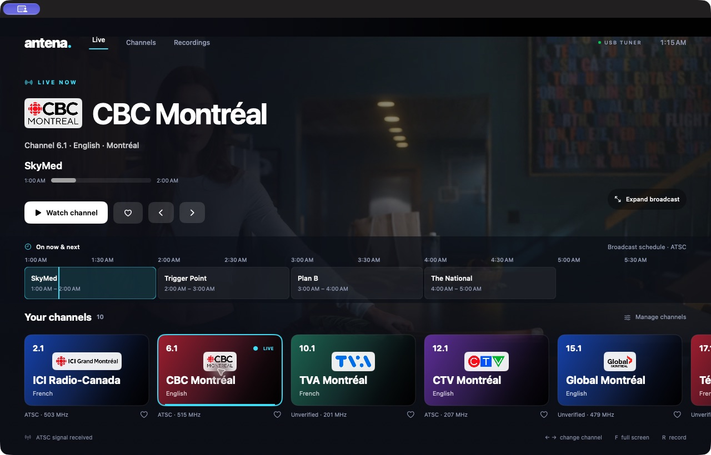
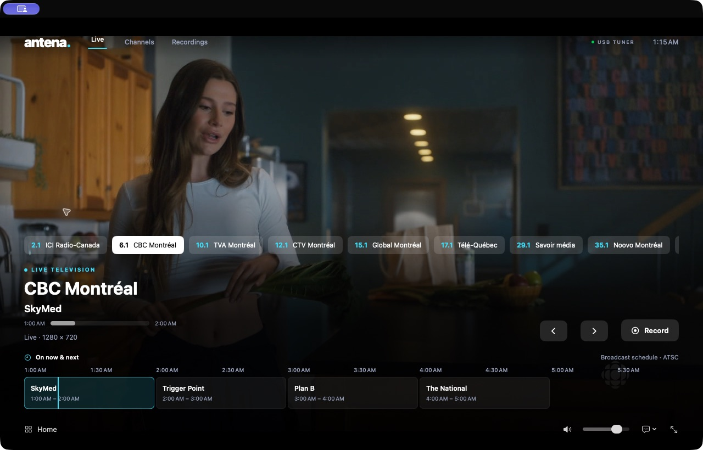

# Antena — Live ATSC television for macOS

[English](README.md) · [Español](README.es.md) · [Français](README.fr.md)

Antena is a native SwiftUI/AppKit application for watching over-the-air television with a **KWorld VS-ATSC 330U** USB tuner. It includes a C userspace driver, live playback through libVLC, optional MPEG-TS recording, channel management and station logos.

The project targets **macOS 27 or later on Apple Silicon** and opens directly in **Xcode 27**. It is an experimental hardware-specific project, not an official KWorld driver. The default documentation and source identifiers are in English.

## Screenshots

Real captures of Antena receiving CBC Montréal over the USB tuner. The interface and controls are shown in English.

### Dashboard

Station logos, the current program and the horizontal now/next guide alongside live video.



### Live player

Quick channel switching, recording, volume, captions and full-screen controls. Controls hide automatically during playback.



Broadcast images and station logos belong to their respective rights holders.

## Contents

1. [Features and status](#features-and-status)
2. [Requirements](#requirements)
3. [Build and run](#build-and-run)
4. [Watching and recording](#watching-and-recording)
5. [Channels and city catalogs](#channels-and-city-catalogs)
6. [Languages](#languages)
7. [Xcode previews](#xcode-previews)
8. [Command-line driver](#command-line-driver)
9. [Architecture and files](#architecture-and-files)
10. [Tests and diagnostics](#tests-and-diagnostics)
11. [Troubleshooting](#troubleshooting)
12. [Preparing a public repository](#preparing-a-public-repository)
13. [Limitations and licensing](#limitations-and-licensing)

## Features and status

- Live video and audio without creating a video file; a bounded memory buffer feeds the decoder.
- Dashboard with station logos, favorites, quick channel switching and numeric channel entry.
- Player controls that hide after 3.5 seconds of inactivity, full screen, volume and mute.
- Caption track selection when the broadcast supplies compatible tracks.
- Broadcast program title, start/end times, progress and a horizontal now/next timeline starting with the current program.
- Explicit recording to `.ts`, playback from the video icon or Play button, Reveal in Finder and automatic removal of missing-file entries.
- Worldwide city catalog discovery, explicit frequency/standard compatibility status, manual editing and RF 2–36 antenna scanning.
- English, Spanish and French interfaces, with automatic macOS language matching.
- Isolated SwiftUI previews for designing screens without activating the tuner.

Live reception was verified with the physical tuner on Apple Silicon/macOS 27.0.1, including ICI Radio-Canada at **503 MHz** and CBC Montréal at **515 MHz**, with video/audio playback. These observations do not guarantee reception at another location. Earlier transport-level measurements are retained in [reception-test.txt](docs/reception-test.txt); they describe that particular test, not all subsequent app testing.

## Requirements

| Component | Requirement |
| --- | --- |
| Mac | Apple Silicon; the app target and bundled runtime are arm64 |
| System | macOS 27+ |
| Development | Xcode 27, active command-line tools, `make`, Swift |
| Tuner | KWorld VS-ATSC 330U, USB VID/PID `eb1a:a316` |
| Chipset | EM2883 (`0x24`), S5H1409 demodulator, XC3028 tuner |
| Signal | ATSC 1.0 terrestrial 8VSB, 6 MHz; connected antenna |
| Playback dependency | libVLC 3.0.24 arm64 under `Vendor/VLC/` |
| Firmware | Verified `firmware/xc3028-v27.fw` |
| Storage | Space for build caches and the staged application, plus any recordings you choose to save |

Internet access is needed to bootstrap VideoLAN and to import online city catalogs or remote logos. It is not needed for an already prepared app to tune a saved frequency. The ten Montréal logos and catalog are bundled.

## Build and run

### Build from the project root

```sh
./script/build_and_run.sh --verify
```

The script builds and launches Antena. `--verify` also checks that its process starts; it does not verify reception. To choose a reproducible build-products directory:

```sh
ANTENA_DERIVED_DATA="$PWD/build/Xcode" ./script/build_and_run.sh --verify
```

Build products are placed under the selected DerivedData directory. When signing requires APFS staging, the script prepares `/private/tmp/Antena-Local/Antena.app` and launches that copy. This temporary application can be recreated by running the script. See [build details](docs/BUILD.md).

### A fresh source checkout

Run commands from the project root. Prepare VideoLAN with the bootstrap script and provide the exact firmware described in [firmware provenance](firmware/PROVENANCE.md) before verification:

```sh
./script/bootstrap_vlc.sh
./script/antena_tools.sh verify-firmware
./script/build_and_run.sh
```

The bootstrap script downloads the official VideoLAN arm64 distribution and checks its pinned SHA-256. Neither VideoLAN binaries nor the firmware are tracked in Git. The normal build does not download missing dependencies automatically. Firmware extraction provenance is documented; there is no automatic firmware acquisition command.

The expected firmware is **66,220 bytes**, version **2.7**, with **80 images**, SHA-256:

```text
0d4cfd7974a19a94f4d42eb2d160d5a3e71cca1cfa61bd2cc063cf3f36ffd32e
```

The driver validates the firmware before tuning and uploads it to tuner RAM, without writing its EEPROM.

### Xcode

Open `Antena.xcodeproj`, select scheme **Antena** and destination **My Mac**. On APFS, build and run normally with `⌘B` and `⌘R`. No paid developer account is needed for the current local ad hoc workflow. For direct Xcode builds, keep DerivedData on APFS with enough free space. The script also handles builds that require APFS staging.

`script/Tools/ProjectGenerator.swift` deterministically regenerates the project. When changing generated project structure or build settings, update the generator as well. It excludes `._*` metadata from source files and keeps USB helper/test files visible without adding them to the app target.

## Watching and recording

The current program and a six-hour horizontal timeline appear when the station supplies usable ATSC PSIP data. Titles, times and progress come from the broadcast, without recording video. See [program guide details and encoding limits](docs/PROGRAM_GUIDE.md).

At startup, Antena tunes the first channel in the saved library and displays the dashboard. Click a station card to switch or **Watch channel** to focus on the video. Move the pointer or press a key to reveal hidden controls.

Recording starts only after **Record** and confirmation of a destination file. It stores the received MPEG transport stream without transcoding, starting at the current live position. Existing files are not overwritten. Stopping a recording leaves live playback running; changing channel or closing the app finishes the active recording. The recording contains the received transport, potentially including multiple programs and data, rather than an exported single-program MP4.

The video icon and **Play** button both start playback. Missing files are removed from the library when this view opens, when Antena becomes active again and during periodic checks while the view remains open. Existing files are not deleted.

Use **Recordings** to play library entries or reveal files in Finder. **File → Open recording…** opens an external recording. Captions depend on the broadcast and decoder; Antena does not generate captions. Changing interface language does not translate broadcast audio or captions.

| Shortcut | Action |
| --- | --- |
| `←` / `→`, Page Up / Page Down | Previous / next channel |
| Digits and `.` | Enter a virtual channel, such as `6.1` |
| `L` | Last channel |
| `F` | Full screen |
| `R` | Start / stop recording |
| `M` | Mute / unmute |
| `C` | Toggle the first available caption track |
| `Esc` | Leave full screen or return to the dashboard |
| `⌘O` | Open a recording |
| `⌘,` | Settings |

The Television menu also exposes channel and recording commands with their displayed shortcuts.

## Channels and city catalogs

In **Channels**, enter a city anywhere in the world, optionally with its country or region, and select **Find and import**. Wikipedia and Wikidata identify the place and available terrestrial station articles. Only the published RF or explicit MHz frequency is used; virtual channel numbers are never converted into RF. Imports preserve existing channels and favorites.

Importing a catalog does not test signal reception. **Scan channels** uses the physical tuner across RF 2–36 and interrupts live television. Newly detected frequencies may appear as RF labels until renamed. Manual entries use MHz; driver commands use Hz.

The bundled Montréal catalog was documented on October 22, 2026. It is a starting catalog, not a promise that every station is receivable:

| Virtual | Station | RF | MHz |
| --- | --- | --- | --- |
| 2.1 | ICI Radio-Canada · CBFT-DT | 19 | 503 |
| 6.1 | CBC Montréal · CBMT-DT | 21 | 515 |
| 10.1 | TVA Montréal · CFTM-DT | 11 | 201 |
| 12.1 | CTV Montréal · CFCF-DT | 12 | 207 |
| 15.1 | Global Montréal · CKMI-DT-1 | 15 | 479 |
| 17.1 | Télé-Québec · CIVM-DT | 26 | 545 |
| 29.1 | Savoir média · CFTU-DT | 29 | 563 |
| 35.1 | Noovo Montréal · CFJP-DT | 35 | 599 |
| 47.1 | ICI Télé · CFHD-DT | 31 | 575 |
| 62.1 | Citytv Montréal · CJNT-DT | 17 | 491 |

Worldwide discovery depends on public source coverage and formatting; complete listings for every city are not guaranteed. Entries with missing frequencies or incompatible broadcast standards remain catalog-only and cannot be tuned by this ATSC 1.0 receiver. Montréal falls back to its bundled catalog when lookup is unavailable. See [city catalog details](docs/CHANNELS.md) and [logo attribution](docs/channel-logo-sources.json).

## Languages

English is the development language and fallback. By default Antena follows the macOS preferred-language list, matching English, Spanish or French, including regional variants such as `es-CA` and `fr-CA`. When no supported preference matches, it uses English.

**Antena → Settings → Interface language** selects **Follow macOS**, **English**, **Español** or **Français**. Manual changes apply on the next launch. Source identifiers, preview names and localization keys remain English. Translations live in `Antena/Resources/en.lproj`, `es.lproj` and `fr.lproj`, exposed as `Localizable.strings` in Xcode. Station names retain their official spelling.

## Xcode previews

Select a file under `Antena/Views`, then enable **Editor → Canvas** (`⌥⌘↩`). Click **Resume** if Xcode pauses previews. Previews cover the dashboard, player, channels, recordings, logos and cards; language settings are shown disabled in their preview.

Previews use in-memory sample data and an illustrated video placeholder. They do not open the USB tuner, record video, query the city catalog or change saved channel preferences. Run the app for real television.

## Command-line driver

The native helper uses IOKit/IOUSBLib in userspace; it does not install a kernel extension or expose an AVFoundation camera device. These commands build it and respectively show help, read USB descriptors, identify the frontend, tune, capture and inspect a transport file:

```sh
./script/build_driver.sh --help
./script/build_driver.sh
./script/build_driver.sh --frontend-probe
./script/build_driver.sh --tune 515000000
mkdir -p recordings
./script/build_driver.sh --capture 515000000 30 recordings/cbc.ts
./script/antena_tools.sh inspect-ts recordings/cbc.ts
```

The capture destination must not exist and its parent directory must exist. Duration is **1–3600 seconds**. `Ctrl-C` stops capture and cancels pending USB reads. `--stream HZ` produces continuous MPEG-TS on stdout and logs on stderr; the app uses this mode for live playback. Avoid opening the same USB tuner from the app and CLI simultaneously.

The executable is `build/kworld-tv`; `build/kworld-probe` is a compatibility alias. `--transport-test` is a USB diagnostic, not a substitute for reception validation. Exit codes: **0** success, **1** USB/firmware/signal/capture failure, **2** device not connected, **64** invalid usage. `./script/build_and_run.sh` launches the GUI without arguments; use `build_driver.sh` for the descriptor probe.

## Architecture and files

```text
USB tuner → kworld-tv → stdout MPEG-TS → bounded RAM ring → libVLC → video/audio
                               └──── explicit recording → .ts file
```

The C bridge ring is `188 × 32768` bytes (about 5.9 MiB). If decoding falls behind, old bytes are dropped instead of allowing unbounded growth. The app coordinates helper termination before retuning and closes active recording during shutdown.

```text
Antena.xcodeproj/             Xcode project and shared Antena scheme
Antena/
  App/                       App lifecycle and commands
  Models/                    Channel, Recording, CaptionTrack
  Stores/                    Persistent library
  Services/                  Tuner, playback, recording, city catalog
  Views/                     SwiftUI screens and components
  Support/                   Theme, localization, preview fixtures
  Bridge/                    C interface to libVLC and memory ring
  Resources/                 Icons, station logos, en/es/fr.lproj
Sources/                     C USB helper and MPEG-TS transport
Tests/                       Standalone Swift and C tests
script/                      Build, runtime setup, verification, staging
firmware/                    Firmware provenance and local binary
Vendor/VLC/                  Local VideoLAN dependency (not tracked)
Reference/                   Upstream driver references and notices
docs/                        Technical guides and reception evidence
build/                       Generated helper, caches and build log
dist/                        Local distribution artifacts, if generated
```

`LibraryStore` saves channels, city and recording references in UserDefaults, under bundle ID `local.antena.television`. Recordings remain at the paths chosen by the user; the library does not copy them elsewhere. Missing recording files are removed from the library automatically when the recordings view is open. The video icon also starts playback. Online catalog and logo requests go to Wikipedia/Wikimedia; logo loading can use URLSession’s disk cache. Live video uses RAM unless recording is explicitly started.

## Tests and diagnostics

Run from the project root after preparing dependencies. Swift tests are standalone executables, not an Xcode XCTest target:

Set `APP_PATH` to the built application you want to test. The example uses `ANTENA_DERIVED_DATA="$PWD/build/Xcode"`; if the build script staged a signed copy, use the staged application path instead.

```sh
APP_PATH="$PWD/build/Xcode/Build/Products/Debug/Antena.app"
make test
./script/antena_tools.sh self-test

xcrun swiftc Antena/Support/Localization.swift Antena/Models/Channel.swift \
  Antena/Services/CityCatalog.swift Tests/CityCatalogTests.swift \
  -o /private/tmp/AntenaCityCatalogTests
/private/tmp/AntenaCityCatalogTests

xcrun swiftc Antena/Support/Localization.swift Antena/Models/Channel.swift \
  Antena/Stores/LibraryStore.swift Tests/LibraryStoreTests.swift \
  -o /private/tmp/AntenaLibraryTests
/private/tmp/AntenaLibraryTests

xcrun swiftc Antena/Services/RecordingWriter.swift Tests/RecordingWriterTests.swift \
  -o /private/tmp/AntenaRecordingWriterTests
/private/tmp/AntenaRecordingWriterTests

xcrun swiftc Antena/Support/Localization.swift Tests/LocalizationTests.swift \
  -o /private/tmp/AntenaLocalizationTests
/private/tmp/AntenaLocalizationTests "$APP_PATH/Contents/Resources"
```

The tests cover transport packet assembly/continuity with sanitizers, firmware identity, RF mapping and catalog compatibility, library merge/persistence and preview isolation, explicit recording/no overwrite/concurrent writes, and localization matching/translation placeholders. Add `--network` to `AntenaCityCatalogTests` for a real Montréal lookup; that optional test depends on the external service.
Program-guide tests cover PSIP discovery, clock conversion, current/next transitions and corrupted metadata. Library tests verify that missing recordings are pruned persistently while existing video files are retained.

To test playback with an existing sample and write decoder counters without recording live television:

```sh
open -n "$APP_PATH" --args \
  --sample /absolute/path/sample.ts \
  --diagnostics /private/tmp/antena-diagnostics.json
```

Replace the sample path with an existing absolute path. The JSON contains playback state and video/audio/byte counters. A successful build or descriptor probe alone does not demonstrate RF reception. Read **`build/antena-build.log`** for build errors. `./script/build_and_run.sh --debug` starts LLDB; `--logs` or `--telemetry` launches the app and streams process logs.

## Troubleshooting

| Problem | Check |
| --- | --- |
| Tuner not found | Confirm the supported VID/PID, USB connection and adapter; reconnect the device |
| Tuner cannot be opened | Quit another tuner client; isolated execution environments may deny IOKit access |
| No lock or no video | Check antenna placement, local coverage and actual RF frequency; try another station |
| Missing dependencies | Prepare `Vendor/VLC/` and the exact firmware; consult the build log |
| Signing failure on ExFAT | Build with the staging script; sign the staged APFS copy |
| Disk full | Free space for build products and system temporary files |
| Empty city import | Try the English city name, use manual frequencies or scan the antenna |
| Missing logo | Bundled Montréal logos work offline; remote logos depend on Wikimedia and network access |
| Recording cannot be opened | Check whether the original file was moved or removed |
| Wrong interface language | Check Settings and macOS language order, then quit and reopen Antena |
| No Canvas image | Select a view containing `#Preview`, show Canvas and resume; inspect preview build errors |

## Preparing a public repository

The source checkout excludes generated files, downloaded binaries, recordings, personal workspace settings and agent working files through `.gitignore`. To validate the public source boundary and create a clean archive:

```sh
./script/antena_tools.sh prepare-github --check
./script/antena_tools.sh prepare-github
```

The outputs are `dist/Antena-source.zip` and `dist/github-manifest.txt`. Review the manifest before publishing. Nothing is committed or uploaded by these commands. See [publication details](docs/PUBLISHING.md), including how already-tracked files differ from ignored files.

## Limitations and licensing

- Reception is implemented for **ATSC 1.0 8VSB** on the identified hardware revision. Analog NTSC, cable QAM and ATSC 3.0 are not implemented.
- Intel, other USB IDs/revisions and complete coverage of every listed station have not been validated.
- There is one tuner: no simultaneous tuning of two RF frequencies, scheduled recording or timeshift/rewind is implemented. The live program guide covers the tuned frequency when usable PSIP data is available.
- The app is for local development, with ad hoc signing, no Developer ID notarization and no App Store packaging. The helper runs outside App Sandbox.
- The C driver and bridge carry **GPL-2.0-only** notices. Read [LICENSE](LICENSE) and retain upstream notices in `Reference/`.
- VideoLAN libraries/plugins have their own terms retained with the runtime; see `Vendor/VLC/README-VideoLAN.txt` after setup and the upstream [VLC source](https://code.videolan.org/videolan/vlc).
- The extracted firmware has separate provenance and is not covered by the source-code license; see [PROVENANCE.md](firmware/PROVENANCE.md). It is not an official macOS firmware release.
- Station logos and trademarks remain subject to their respective rights and [source attribution](docs/channel-logo-sources.json).

Further technical notes: [app guide](docs/APP.md), [city catalogs](docs/CHANNELS.md), [build details](docs/BUILD.md), [native tools](docs/TOOLS.md), [reception evidence](docs/reception-test.txt).

## About and release DMGs

**Antena → About Antena** shows author **Luigimonsoft**, [GitHub profile](https://github.com/luigimonsoft), project date **October 23, 2026**, version/build and credits.

Run `./script/build_release.sh` to build a Release DMG locally. The included **Build release DMG** GitHub Actions workflow runs manually or on `v…` version tags and uploads the DMG plus checksum as an Actions artifact. Configure the required `XC3028_FIRMWARE_BASE64` secret first. The default package is ad hoc signed and not notarized; it is not published automatically as a GitHub Release. See [release setup and distribution status](docs/RELEASES.md).
